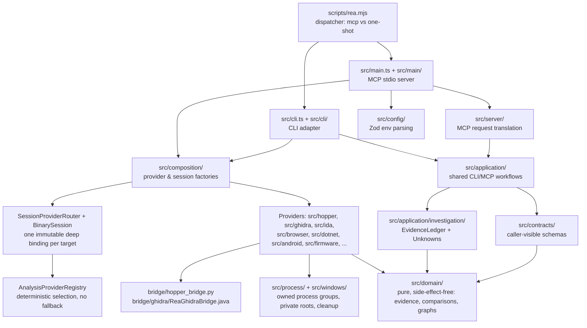

# Architecture

REA is a layered TypeScript codebase. **Dependencies flow inward**: domain semantics and contracts at the core, then provider adapters, then shared application workflows, then the CLI and MCP adapters at the edge. Engine protocols and provider-specific code are kept out of the domain and application layers. The canonical diagram is `docs/architecture.mermaid`; below is a simplified version.

## Layers

### Entry points
| Path | Role |
| --- | --- |
| `scripts/rea.mjs` | The `rea` / `rea-agents` executable. Routes `mcp` (or `--mcp`) to the MCP runtime, everything else to the one-shot CLI. |
| `src/cli.ts`, `src/cli/` | One-shot CLI adapter: setup, diagnostics, analysis, decompilation. Command names live in `src/cliCommandNames.ts`. |
| `src/main.ts`, `src/main/` | MCP stdio server adapter: config, session, process lifetime. |

### Composition
`src/composition/` builds fresh, typed provider and session factories, handles one-shot binding for the CLI, loads optional providers independently, and wires static descriptors (e.g. WASM/EVM) with named contracts and retryable lifetimes.

### Adapters
- `src/server/` translates MCP requests: `createServer`, tool registration, result shaping.
- `bridge/hopper_bridge.py` runs **inside Hopper** and adapts operations to Hopper's Python API.
- `bridge/ghidra/ReaGhidraBridge.java` is a packaged Ghidra `HeadlessScript` covering inventory, decompiler, references and CFG.
- `src/cli/` + `src/application/Setup*` are host installation adapters (macOS verified vendor DMG to `~/Applications`; Linux verified vendor package via apt/dnf/pacman).

### Application layer
- `src/application/` holds the shared workflows that both adapters call.
- `SessionProviderRouter` + `BinarySession`: one immutable deep-provider binding per target, with disjoint auxiliary routing.
- `AnalysisProviderRegistry`: sorted deep candidates, deterministic selection, **no fallback**.
- `src/application/investigation/`: composed `InvestigationRecords`, the `EvidenceLedger`, and ownership of unknowns. See [[Evidence Model]].
- `BinarySessionRecords` + `AnalysisSnapshotCache`: target/profile snapshots. See [[Sessions and Snapshots]].
- `src/application/javascript/` + `src/artifacts/javascript/`: JavaScript artifact reconstruction (directory/ASAR reads, AST-only bundle projection). See [[JavaScript and Electron]].

### Provider layers
| Path | What it wraps |
| --- | --- |
| `src/hopper/` | Hopper launch and Unix-socket protocol ([[Hopper]]) |
| `src/ghidra/` | Ghidra discovery, profile, function analysis, Unix/Windows transport ([[Ghidra]]) |
| `src/ida/` | Upstream IDA MCP contract adaptation, live GUI or owned headless DB ([[IDA]]) |
| `src/browser/`, `src/inspector/` | CDP/Playwright capture, V8 Inspector ([[Websites and Browser Observation]], [[JavaScript Runtime Observation]]) |
| `src/dotnet/` | Managed static metadata ([[DotNET Assemblies]]) |
| `src/android/` | Static APK via pinned headless JADX ([[Android]]) |
| `src/firmware/` | Binwalk / Unblob adapters ([[Firmware]]) |
| `src/native/pwntools/`, `src/native/pwndbg/` | BYO offline ELF/core adapters ([[ELF Layout and Recorded Crashes]]) |
| `src/wasm/`, `src/evm/` | WABT and EVMole adapters ([[WASM Artifacts]], [[EVM Bytecode]]) |
| `src/artifacts/`, `src/native/` | Artifact inventory/extraction, format readers |
| `src/javascript/sourceMaps/` | Pinned source-map codec in a heap-limited Node process |
| `src/reference/` | Historical reference-source reader |

### Process foundation
`src/process/` owns process groups, private roots, deadlines, bounded file reads and cleanup. On Windows, `src/windows/` and `native/windows/src/` (a Node-API addon) provide NTFS admission, protected DACLs and Job Object ownership. Project rules require reusing these primitives: a PID and executable path alone do not prove ownership after exit or reuse.

### Contracts, domain, configuration
- `src/contracts/` holds caller-visible schemas; `src/contracts/errorSchemas.ts` holds shared error schemas used for CLI diagnostics and the generated error catalog.
- `src/domain/` contains pure, side-effect-free modules: evidence, comparisons, application graphs.
- `src/config/` parses the environment with Zod (see [[Environment Variables]]).

### Tests and evaluation
`tests/` is a Vitest suite with fake launcher, bridge and CDP seams in `tests/fixtures/`; `src/evaluation/` scores agent release evaluations. See [[Testing]].

## Design rules worth knowing

> [!info] From AGENTS.md
> - Give each interpretation and resource a single owner; consumers use the owner's parsed facts rather than reinterpret raw source.
> - Preserve identity, omission, uncertainty and source evidence across boundaries. Unresolved identity stays **unknown**, never silently "absent".
> - Retain ownership of resources whose cleanup failed (hence `cleanup_incomplete` results).
> - Model expected failures with a tagged error algebra and `Result`.
> - Catalog ordering must never select an operation or schema.

Performance is optimized in a fixed order: **agent tokens and context first**, then analysis time, then CPU and memory. That is why REA offers summaries, paging and retained Evidence views. See [[Tool Design Principles]].

## Related
- [[Codebase Map]] for a folder-by-folder tour
- [[How REA Works]] for the runtime flow
- [[Providers Overview]]

## Source
- https://github.com/morluto/rea/blob/main/docs/architecture.mermaid
- https://github.com/morluto/rea/blob/main/AGENTS.md
