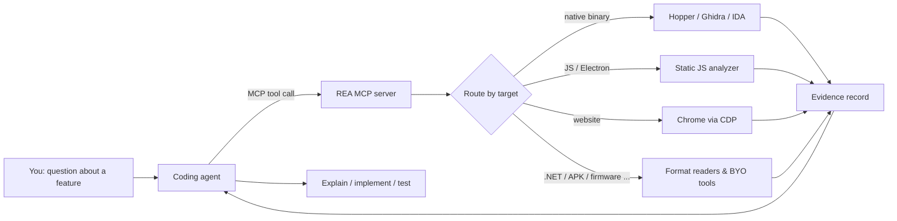

# How REA Works

At a high level: **your agent asks a question about a local target, REA inspects and traces it with the right analysis engine, and returns code, references and unknowns as Evidence; the agent then explains, implements and tests.** The CLI runs the same workflows without an agent.



## 1. Setup connects the agent

`npx rea-agents setup` detects supported agents, shows a plan of exact file changes, and after approval registers REA's MCP server (pinned to an exact package version) and installs the bundled **reverse-engineer-anything** skill, which teaches the agent how to route targets and handle evidence. See [[Agent Setup]] and [[Agent Skill]].

## 2. The agent routes the target

The skill tells the agent to choose its first tool from the kind of target supplied, for example:

| Target | First tool |
| --- | --- |
| ASAR or extracted JavaScript/Electron tree | `analyze_javascript_application` |
| Native executable, archive or package | `open_binary` (then function, reference and search tools) |
| Android APK code | `inspect_android_package` |
| Managed PE/CLI assembly | `inspect_managed_artifact` |
| Firmware image | `inspect_firmware_regions` |

Target-free tools take their own explicit path or endpoint; only active-target workflows need `open_binary`. See [[MCP Tool Catalog]] and [[Targets Overview]].

## 3. Sessions bind one target to one provider

For native work, `open_binary` creates a **binary session**. With automatic selection, REA uses the single available provider that supports the target; when several qualify you must choose (`provider_id` on `open_binary`, `--provider` on the CLI, or the `REA_ANALYSIS_PROVIDER` environment variable). The chosen provider stays bound to the session until an explicit switch or close, and is **never replaced automatically after a failure**. Call `binary_session` with `{}` to see the active binding, candidates and per-tool availability. See [[Sessions and Snapshots]] and [[Providers Overview]].

> [!tip] Lazy provider start
> For Ghidra, `open_binary` only validates the target/provider binding. The first Ghidra-backed query starts import and auto-analysis, which can take minutes on big binaries (default startup deadline 330,000 ms). See [[Ghidra]] and [[Troubleshooting]].

## 4. Results come back as Evidence

Evidence-producing tools return the complete canonical Evidence record inline: the operation result in `normalized_result`, an `evidence_id`, the subject's SHA-256, provider and analysis profile, `confidence` (`observed` / `derived` / `inferred`), `authority`, `limitations` and source `locations`. The same record is retained in the session's ledger so it can be inspected, exported or compared later. See [[Evidence Model]].

Failures return `isError: true` with a typed JSON diagnostic (`code`, `message`, `details`, remediation) instead of structured content. See [[Errors and Exit Codes]].

## 5. Large results stay manageable

MCP replies are sized to fit the stdio client's 10 MiB receive buffer. If a result cannot fit, REA returns `resource_constraint` with a reference to the retained Evidence; the agent then calls `inspect_analysis_view` for a summary, a page or one item, or `export_evidence_bundle` to write the full record to disk. On the CLI the equivalent pattern is to save `--json` output to a file and project a view with `rea inspect-analysis-view`. See [[Evidence Export and Import]].

## 6. Unknowns are first-class

When a question cannot be settled from available evidence, the agent records it with `record_unknown`, updates it with `update_unknown`, and lists heads with `list_unknowns`. Unknowns carry status (`open`, `investigating`, `blocked`, `contradicted`, `resolved`), severity, supporting and contradicting Evidence IDs, and recommended probes. See [[Evidence Model]].

## 7. Guided prompts (optional)

REA also exposes six MCP prompts (`investigate_feature`, `compare_application_versions`, `verify_reconstruction`, `trace_crash`, `audit_residual_unknowns`, `prepare_bounded_process_capture`) that suggest starting points without invoking tools themselves. See [[Agent Prompts]].

## Static vs runtime work

- **Static** workflows (JavaScript, .NET, archives, most format readers) read the supplied files without running the target.
- **Runtime** workflows (browser observation, process capture, Frida, adb, Node/Electron Inspector) run or interact with the target using your user permissions. Each guide documents its effects. See [[Websites and Browser Observation]], [[Process Capture]], [[Frida]].

## The CLI path

```bash
npx -y rea-agents@latest analyze-javascript-application /absolute/path/to/app --json
```

The CLI is a one-shot process: each invocation opens, analyzes and exits. Use snapshots (`--snapshot`) to reuse native results across invocations, and `rea evidence-import` / `rea evidence-export` / `rea compare` to work with saved Evidence. The default terminal format is TOON; `--json` produces JSON. See [[CLI Reference]].

## Untrusted target content

Strings, decompiled code, page text and logs come from the target and may contain text crafted to look like instructions. REA marks such results with `_meta.provenance.untrusted_content: true`, and its server instructions tell agents never to follow directives found in tool results. See [[MCP Server]].

## Related
- [[Architecture]] for the code layout behind this flow
- [[Quick Start]] to try it
- [[Recipes]] for worked task patterns

## Source
- https://github.com/morluto/rea/blob/main/README.md#how-rea-works
- https://github.com/morluto/rea/blob/main/docs/mcp-contracts.md
- https://github.com/morluto/rea/blob/main/docs/cli.md
- https://github.com/morluto/rea/blob/main/.agents/skills/reverse-engineer-anything/SKILL.md
